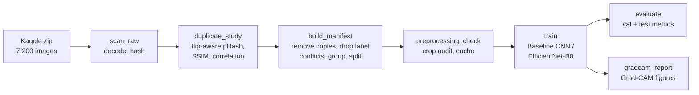
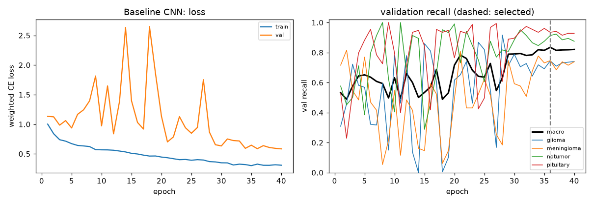
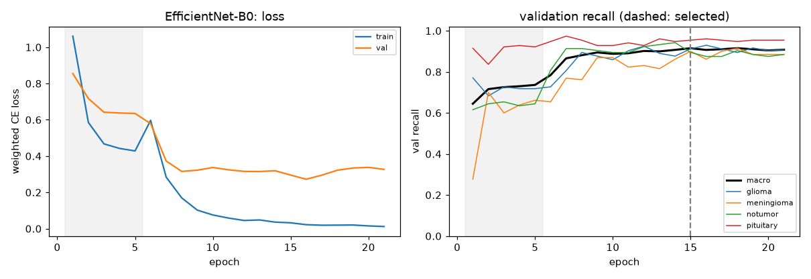
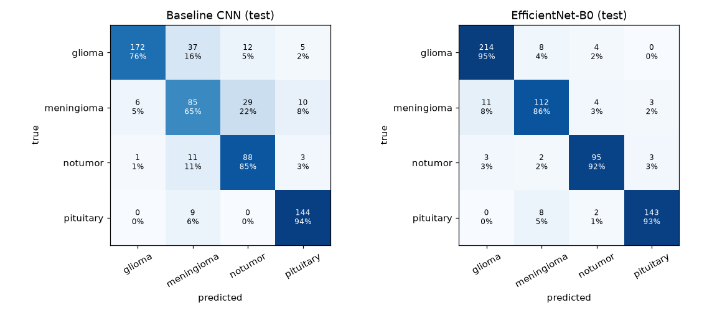
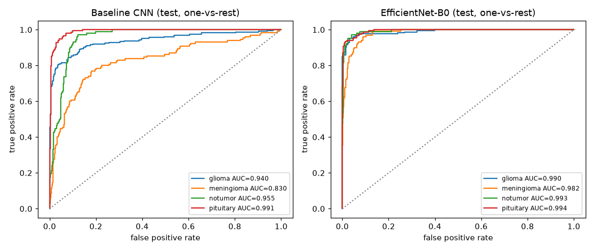
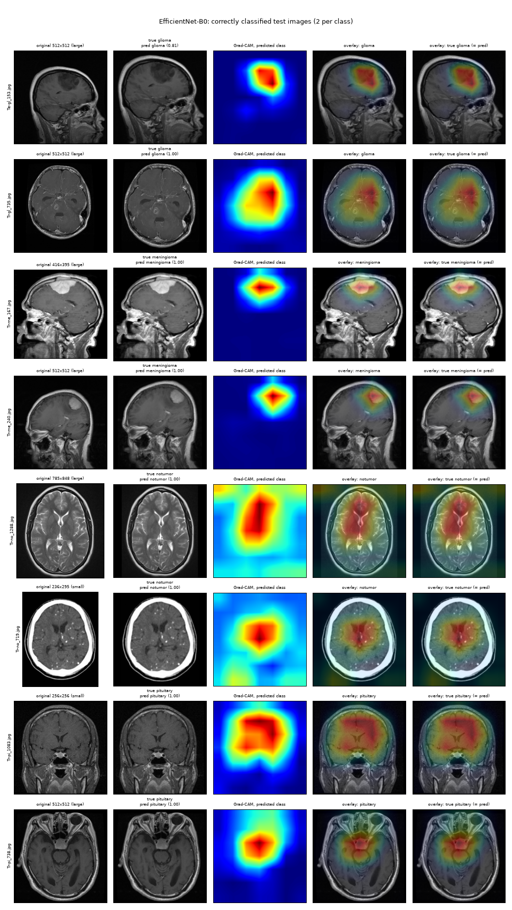
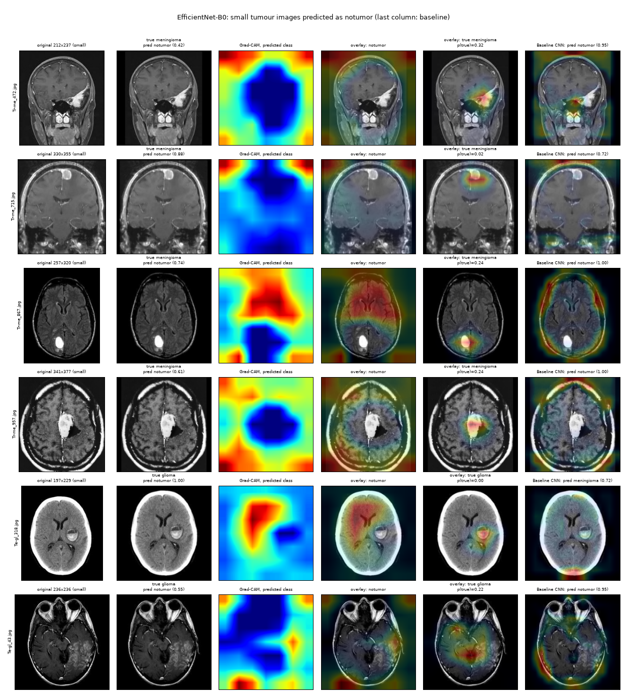

# Brain tumour MRI classification: a scratch CNN vs EfficientNet-B0, with Grad-CAM

[](https://github.com/MehardeepS30/brain-tumor-mri-classification/actions/workflows/tests.yml)   [](LICENSE) [](https://creativecommons.org/licenses/by/4.0/)

This project classifies 2D brain MRI slices into **glioma, meningioma, pituitary tumour, or no tumour**. It compares a small CNN trained from scratch with an ImageNet-pretrained EfficientNet-B0 fine-tuned in two stages. Recall is the main metric, because a missed tumour is the costly error. Grad-CAM is used to check where each model's evidence sits in the image.

Most of the work went into making the evaluation trustworthy: removing duplicates, preventing leakage between splits, and measuring a resolution/source shortcut that is still present in the final models.

> **Not a medical device.** The models were trained and tested on public, web-collected 2D images without patient IDs. The results below are classification metrics on that dataset only. They do not establish clinical reliability or suitability for diagnosis, and EfficientNet-B0 here is **not** clinically validated. See [Limitations](#15-limitations).

**Headline results** (untouched test split, n = 612, checkpoint selected on validation):

| | Test macro recall (95% CI) | Test accuracy | Tumours called "no tumour" |
|---|---|---|---|
| Baseline CNN | 0.803 (0.769–0.832) | 0.799 | 41 / 509 |
| EfficientNet-B0 | **0.916 (0.893–0.940)** | **0.922** | **10 / 509** |

**Per-class test recall:** glioma 0.761 → 0.947, meningioma 0.654 → 0.862, no tumour 0.854 → 0.922, pituitary 0.941 → 0.935 (baseline → EfficientNet-B0).

**Documentation:**
- [`docs/model_card.md`](docs/model_card.md): intended use, performance and risks.
- [`docs/data_validation_report.md`](docs/data_validation_report.md): the data audit.
- [`docs/training_results.md`](docs/training_results.md): the training and test write-up.
- [`CHANGELOG.md`](CHANGELOG.md): release notes.

Contents:

1. [Overview and objectives](#1-overview-and-objectives)
2. [Dataset and classes](#2-dataset-and-classes)
3. [Cleaning, duplicates and leakage prevention](#3-cleaning-duplicates-and-leakage-prevention)
4. [Preprocessing and augmentation](#4-preprocessing-and-augmentation)
5. [Splits](#5-splits)
6. [Baseline CNN](#6-baseline-cnn)
7. [EfficientNet-B0 transfer learning](#7-efficientnet-b0-transfer-learning)
8. [Training configuration](#8-training-configuration)
9. [Evaluation methodology](#9-evaluation-methodology)
10. [Results](#10-results)
11. [Grad-CAM](#11-grad-cam)
12. [Resolution/source shortcut and failure modes](#12-resolutionsource-shortcut-and-failure-modes)
13. [Setup and commands](#13-setup-and-commands)
14. [Repository structure and reproducibility](#14-repository-structure-and-reproducibility)
15. [Limitations](#15-limitations)
16. [Future work](#16-future-work)
17. [Licensing and attribution](#licensing-and-attribution)

---

## 1. Overview and objectives

- **Build a from-scratch baseline and a transfer-learning model** under the same data, preprocessing, loss and model-selection rule, so the comparison is fair.
- **Put recall first.** The reports give per-class recall, precision, ROC/AUC and confusion matrices, not just accuracy.
- **Make the test set honest.** That means removing duplicates across splits, handling conflicting labels, and keeping the test split untouched until both models were final.
- **Use Grad-CAM to inspect, not to prove.** It shows where each model's class evidence is concentrated.

Everything is a Python package (`src/brain_tumor/`) with `pytest` tests and one script per stage (`scripts/`), driven by JSON configs (`configs/`).



## 2. Dataset and classes

- **Source:** Kaggle, [`masoudnickparvar/brain-tumor-mri-dataset`](https://www.kaggle.com/datasets/masoudnickparvar/brain-tumor-mri-dataset), files dated 2026-02-13.
- **Zip SHA-256:** `882817250048c78ef7a759cf23e540d7b581f2327b16663c9d3db12f5d2ffdb4`.
- **Contents:** 7,200 images (`Training/` 4 × 1,400 and `Testing/` 4 × 400), all decodable.
- **Format:** 447 distinct image sizes, 70% of them 512×512.
- **Origin:** according to its Kaggle description, the dataset combines the figshare, SARTAJ and Br35H collections, and all "no tumour" images come from Br35H. This is relevant to the source shortcut in [section 12](#12-resolutionsource-shortcut-and-failure-modes).
- **Licence:** CC BY 4.0 (see [Licensing and attribution](#licensing-and-attribution)). The images are not redistributed here; the figures in `reports/` show processed examples with attribution.

The class mapping is fixed in `src/brain_tumor/classes.py` and matches the folder names:

| Index | Class | Raw images | Kept after cleaning |
|---|---|---|---|
| 0 | `glioma` | 1,800 | 1,509 |
| 1 | `meningioma` | 1,800 | 868 |
| 2 | `notumor` | 1,800 | 689 |
| 3 | `pituitary` | 1,800 | 1,021 |

**No patient IDs.** File names are counters (`Tr-gl_123.jpg`). Metadata exists on only 30 web-sourced files and contains no patient fields.

## 3. Cleaning, duplicates and leakage prevention

The raw files in `data/raw/` are never modified; they are extracted once and marked read-only. All evidence is in [`reports/data/`](reports/data/), and the full write-up is [`docs/data_validation_report.md`](docs/data_validation_report.md).

**What was found:**
- **Flipped and rotated copies.** Perceptual hashing (pHash) is not flip-invariant, so each image is hashed in all 8 flips/rotations and the smallest distance is used. Of the 10,039 pairs at distance 0, 8,109 were only found this way.
- **Re-encoded copies across Kaggle's own split.** The dataset description states that duplicates and train/test overlap were removed, and indeed no file is byte-identical across `Training/` and `Testing/`. Yet **989 of Kaggle's 1,600 test images have a near-exact copy in its training folder**, and 1,414 have a copy or closely related image. Results on the original split are therefore optimistic.
- **The planned pHash ≤ 6 threshold was rejected.** It chains unrelated images into one 1,688-image group. Also, 12.5% of pairs at distance 6 carry different labels; true copies almost never do, while random pairs differ in label 75% of the time.

**Rules applied** (`scripts/build_manifest.py`, evidence in [`duplicate_threshold_evidence.png`](reports/data/duplicate_threshold_evidence.png)):
1. **Augmented copies:** drop the 203 `*-aug-*` meningioma files, the dataset author's augmented copies.
2. **Copies (removed, keeping the largest):** identical SHA-256, or flip-aware pHash ≤ 2 with aligned pixel correlation ≥ 0.99.
3. **Conflicting labels:**
   - A copy cluster with more than one label is dropped entirely (17 images).
   - A near-identical pair (correlation ≥ 0.95 or SSIM ≥ 0.9) with different labels is also dropped (6 images, 3 mirrored re-saves).
   - The 101 look-alike pairs with different labels are kept but listed in [`conflicts.csv`](reports/data/conflicts.csv).
4. **Related groups (kept, always in the same split):** pHash ≤ 4, or ≤ 6 with SSIM ≥ 0.6, or SSIM ≥ 0.7. The rule deliberately over-groups, since an extra link only costs split flexibility while a missed link leaks data. This gives 1,737 groups; the largest has 228 images.
5. **Leakage checks:** the manifest build asserts that every group sits in one split and that **no near-identical or related pair of kept images crosses splits**. The most similar cross-split pair left (SSIM 0.72, correlation 0.76) is within the range of random pairs.

Result: **4,087 kept images** out of 7,200. The reasons for every exclusion are in `data/excluded.csv`.

## 4. Preprocessing and augmentation

Defined in `src/brain_tumor/transforms.py`. The deterministic steps are cached once as 224×224 PNGs (`data/processed/`). A check confirms cached and uncached eval tensors are identical (maximum difference 0.0 on 200 images).

1. **Greyscale.** Some files are RGB, RGBA or palette images with grey content.
2. **Crop to the head.**
   - **Foreground:** pixels above ½ × the Otsu threshold.
   - **Head regions:** every connected region at least 2% the size of the largest; smaller specks and burned-in scanner text are dropped. The bounding box gets a 5% margin.
   - **Why "every region":** an earlier version kept only the largest region and cut off half the head on scans with a broken skull ring (once through a tumour). It was found on real images and is covered by a test.
   - **Audit:** across all kept images, the median share of foreground left outside the crop is 0%, and the maximum is 6%, all of it corner text ([`crop_worst_cases.png`](reports/data/crop_worst_cases.png)).
3. **Pad to square with black, then resize to 224×224.** The aspect ratio is preserved.
4. **Replicate to 3 channels and normalise** with ImageNet statistics, mean (0.485, 0.456, 0.406) and std (0.229, 0.224, 0.225). These are read from torchvision's EfficientNet-B0 weights, and the baseline uses the same values.

**Training-only augmentation:** random resolution (p = 0.5, downscale to 35–100% and back), horizontal flip, ±10° rotation, and ±10% brightness/contrast. Vertical flips are excluded. Validation and test preprocessing is deterministic, and a test checks this.

Example grids: [glioma](reports/data/crop_grid_glioma.png), [meningioma](reports/data/crop_grid_meningioma.png), [no tumour](reports/data/crop_grid_notumor.png), [pituitary](reports/data/crop_grid_pituitary.png), [augmentation](reports/data/augmentation_grid.png).

## 5. Splits

The split is a group-aware, stratified 70/15/15 split with seed 42 (`src/brain_tumor/splits.py`). Groups are shuffled within each class and placed largest-first into the split furthest below its target.

| | glioma | meningioma | notumor | pituitary | total |
|---|---|---|---|---|---|
| train | 1,056 | 608 | 482 | 715 | **2,861** |
| val | 227 | 130 | 104 | 153 | **614** |
| test | 226 | 130 | 103 | 153 | **612** |

Class proportions agree across splits within 0.2 percentage points.

## 6. Baseline CNN

`BaselineCNN` in `src/brain_tumor/models.py`:

```
input 3×224×224
4 × [Conv 3×3 (no bias) → BatchNorm → ReLU → MaxPool 2×2], channels 32, 64, 128, 256
→ 256×14×14  (Grad-CAM layer: features[-1])
→ global average pool → Dropout(0.3) → Linear(256, 4)
```

It has exactly **389,924** parameters. The count is checked in `tests/test_models.py`:

$$\sum_{(c_{in},c_{out})}\left(9\,c_{in}c_{out}+2c_{out}\right)+(256\cdot4+4)=389{,}924$$

## 7. EfficientNet-B0 transfer learning

`EfficientNetB0Classifier` uses the torchvision backbone with `IMAGENET1K_V1` weights. The 1000-class head is replaced with Dropout(0.2) → Linear(1280, 4), giving 4,012,672 parameters. Its Grad-CAM layer is `features[-1]`, with output 1280×7×7.

- **Stage A, frozen (epochs 1–5):** only the 5,124 head parameters train. The backbone's BatchNorm layers are held in eval mode, so the ImageNet running statistics do not drift. A test checks that this actually leaves the backbone unchanged, not just that its `requires_grad` flags are off.
- **Stage B, fine-tuning (from epoch 6):** everything trains. The backbone uses learning rate 1e-4 and the head 1e-3, each with a fresh warm-up plus cosine schedule.

## 8. Training configuration

The shared training loop is `src/brain_tumor/train.py`, and the configs are [`configs/baseline.json`](configs/baseline.json) and [`configs/efficientnet_b0.json`](configs/efficientnet_b0.json).

| | Baseline | EfficientNet-B0 |
|---|---|---|
| Loss | Class-weighted cross-entropy | same |
| Optimiser | AdamW, weight decay 1e-4 | same |
| Peak learning rate | 1e-3 | A: 1e-3 (head); B: 1e-4 backbone, 1e-3 head |
| Schedule | 1-epoch linear warm-up, then per-step cosine decay to 1% | per stage |
| Batch size, precision | 32, fp16 autocast + GradScaler | same |
| Max epochs / patience | 40 / 8 | 5 frozen + 25 / 6 (fine-tune stage only) |

- **Class weights:** $\mathcal{L}=-\frac1B\sum_i w_{y_i}\log\mathrm{softmax}(z_i)_{y_i}$ with $w_c=N/(4n_c)$, computed from the train split only: glioma 0.677, meningioma 1.176, notumor 1.484, pituitary 1.000.
- **Model selection and early stopping:** both use **validation macro recall**, with a minimum improvement of 0.002 and ties broken by lower validation loss. The test split is never loaded during training, and a test checks this.
- **Checkpoints:**
  - `best.pt` and `last.pt` store the model, optimiser, scheduler, scaler and counters.
  - Each epoch is re-seeded from (seed, epoch), so a resumed run reproduces an uninterrupted one bit for bit. This is tested on CPU and was confirmed on the GPU in the smoke test.
  - Per-epoch metrics go to `outputs/<model>/log.csv`.
- **Data loading:** `num_workers` is 0 on purpose. On Windows each worker took about 6 s to start, and the cached PNGs load in about 0.08 s per batch.

## 9. Evaluation methodology

`scripts/evaluate.py` loads each run's `best.pt`, which was chosen on validation, and evaluates it once on the test split.

$$\text{macro recall}=\frac14\sum_c\frac{TP_c}{TP_c+FN_c}$$

**Why macro recall:**
- A missed tumour is the costly error, so recall is the main metric.
- Averaging over classes keeps a large class from hiding a weak one.
- It is also the metric the checkpoints were selected on.

The evaluation also reports:
- per-class precision, recall and F1;
- one-vs-rest ROC curves and AUC per class;
- confusion matrices;
- a 95% percentile bootstrap interval for macro recall (1,000 image resamples).

The bootstrap interval reflects test-set sampling only (see [Limitations](#15-limitations)). All numbers below are read from [`reports/results/metrics.json`](reports/results/metrics.json).

## 10. Results

### Selected checkpoints and learning curves

| | Epochs run | Selected epoch | Best val macro recall |
|---|---|---|---|
| Baseline CNN | 40 (no early stop) | 36 | 0.835 |
| EfficientNet-B0 | 21 (early stop) | 15 (fine-tune stage) | 0.915 |

| Baseline | EfficientNet-B0 |
|---|---|
|  |  |

- **Baseline:** validation recall swung widely while the learning rate was high (glioma recall fell to 0 at epoch 14). It settled as the cosine schedule lowered the rate, which is why the checkpoint is chosen on validation.
- **EfficientNet:** validation recall rose quickly once the backbone was unfrozen at epoch 6, and plateaued around 0.90–0.915 from epoch 12 on.

### Test metrics (n = 612)

| | Macro recall (95% CI) | Accuracy | Macro AUC |
|---|---|---|---|
| Baseline CNN | 0.803 (0.769–0.832) | 0.799 | 0.929 |
| EfficientNet-B0 | 0.916 (0.893–0.940) | 0.922 | 0.990 |

Validation results for comparison: baseline 0.832 (0.804–0.859), EfficientNet 0.916 (0.893–0.939).

| Class (test n) | Baseline precision | Baseline recall | Baseline AUC | EffNet precision | EffNet recall | EffNet AUC |
|---|---|---|---|---|---|---|
| glioma (226) | 0.961 | 0.761 | 0.940 | 0.939 | 0.947 | 0.990 |
| meningioma (130) | 0.599 | 0.654 | 0.830 | 0.862 | 0.862 | 0.982 |
| notumor (103) | 0.682 | 0.854 | 0.955 | 0.905 | 0.922 | 0.993 |
| pituitary (153) | 0.889 | 0.941 | 0.991 | 0.960 | 0.935 | 0.994 |

| Confusion matrices (test) | ROC curves (test, one-vs-rest) |
|---|---|
|  |  |

**What the measurements show:**
- **EfficientNet-B0 beats the baseline on every summary metric,** and the two macro-recall intervals do not overlap.
- **Baseline errors:** most go into meningioma and "no tumour". 37 gliomas were called meningioma, and 29 meningiomas were called "no tumour". In total it calls 41 tumours "no tumour" (8.1%).
- **EfficientNet errors:** it calls 10 tumours "no tumour" (2.0%). Its most common confusion is meningioma ↔ glioma (11 and 8 images).
- **Pituitary** is the easiest class for both models, with AUC 0.991 and 0.994.

## 11. Grad-CAM

**Method** (`src/brain_tumor/gradcam.py`, Selvaraju et al., 2017). For class $c$ and target-layer activations $A^k$:

$$\alpha^c_k=\frac1{HW}\sum_{i,j}\frac{\partial y^c}{\partial A^k_{ij}},\qquad L^c=\mathrm{ReLU}\Big(\sum_k\alpha^c_kA^k\Big)$$

$L^c$ is upsampled to 224×224 and scaled to [0, 1] per image. Implementation details:
- **Target layer:** each model's `gradcam_layer` (`features[-1]`), which is 14×14 for the baseline and 7×7 for EfficientNet.
- **Gradient source:** the gradient of the requested class's logit, taken with respect to the activations only. The model runs in eval mode, and its parameters, `.grad` and BatchNorm statistics are left unchanged; tests check this, including on the saved checkpoints.
- **Blank maps:** both models end in global average pooling and a linear layer, so the pre-ReLU map averages to the image's evidence for the class ($(y_c-b_c)/HW$, tested). A blank map therefore means "no positive evidence for this class", not a failure, and figures label such maps "[blank]". On the test set, 0 predicted-class maps were blank, and 1 true-class map was blank (EfficientNet).

**Figures** (`scripts/gradcam_report.py`, test split, the selected checkpoints). Each row shows:
- the original image, with its size;
- the model input, with true label, predicted label and confidence;
- the predicted-class heatmap;
- its overlay;
- the true-class overlay.

| | Baseline CNN | EfficientNet-B0 |
|---|---|---|
| Correct, 2 per class | [baseline_correct](reports/gradcam/baseline_correct.png) | [efficientnet_b0_correct](reports/gradcam/efficientnet_b0_correct.png) |
| Misclassified, ≤2 per true class | [baseline_misclassified](reports/gradcam/baseline_misclassified.png) | [efficientnet_b0_misclassified](reports/gradcam/efficientnet_b0_misclassified.png) |
| Tumours predicted as notumor | [baseline_tumour_as_notumor](reports/gradcam/baseline_tumour_as_notumor.png) | [efficientnet_b0_tumour_as_notumor](reports/gradcam/efficientnet_b0_tumour_as_notumor.png) |
| Correct tumours, 4 small then 4 large | [baseline_small_vs_large](reports/gradcam/baseline_small_vs_large.png) | [efficientnet_b0_small_vs_large](reports/gradcam/efficientnet_b0_small_vs_large.png) |
| Least vs most map weight inside the head | [baseline_focus_extremes](reports/gradcam/baseline_focus_extremes.png) | [efficientnet_b0_focus_extremes](reports/gradcam/efficientnet_b0_focus_extremes.png) |



**Measured map locations.** The heatmaps for all 612 test images are summarised by where their weight falls ([`summary.json`](reports/gradcam/summary.json), per-image values in `cam_stats_*.csv`):
- **Head share:** the fraction of map weight inside the head mask.
- **Border share:** the fraction within 11 px of the image edge.
- **Reference values for a perfectly flat map:** head share 0.57, border share 0.187.

| Predicted-class map, median | Baseline head | Baseline border | EffNet head | EffNet border |
|---|---|---|---|---|
| All test images (612) | 0.639 | 0.130 | 0.881 | 0.029 |
| Correct large tumours (393 / 441) | 0.686 | 0.120 | 0.902 | 0.017 |
| Correct small tumours (8 / 28) | 0.684 | 0.190 | 0.910 | 0.034 |
| Correct "no tumour" (88 / 95) | 0.536 | 0.141 | 0.632 | 0.151 |
| Tumours called "no tumour" (41 / 10) | 0.537 | 0.162 | 0.494 | 0.248 |

These numbers describe where the maps put weight; they are not a measure of correctness. The dataset has no tumour masks, so overlap with the actual lesion could only be judged visually.

**Visual observations** (qualitative):
- **EfficientNet-B0, tumour predictions:** in the inspected correct glioma and meningioma examples, the map is a compact blob over the visible lesion, for both small and large originals ([small vs large](reports/gradcam/efficientnet_b0_small_vs_large.png)).
- **EfficientNet-B0, pituitary:** the maps are broader. Some sit over the sellar/suprasellar region, while others cover the upper brain in coronal slices without an obvious focus on the sella.
- **EfficientNet-B0, "no tumour":** the maps are diffuse over the brain or extend to the image periphery. This is consistent with the lower head share above.
- **Baseline CNN:** the maps are fragmented, and often lie on the skull rim, scalp, neck or image edge rather than the lesion. One correct meningioma (`Tr-me_158`) is a clear exception, with the map on the mass.
- **Baseline, tumours it called "no tumour":** the "no tumour" map mostly traces the skull outline and the image border ([figure](reports/gradcam/baseline_tumour_as_notumor.png)).
- **Hypothesis, not demonstrated:** the baseline relies substantially on head outline and peripheral appearance, which would fit its strong dependence on image source (section 12).

## 12. Resolution/source shortcut and failure modes

"Small" means the original image's longest side is under 400 px. In the test split, 73 of the 103 "no tumour" images are small, but only 42 of the 509 tumour images are. A random forest given only width, height and aspect ratio reaches validation macro recall 0.437 (chance is 0.25).

| Test tumours called "no tumour" | Small originals (42) | Large originals (467) | Fisher exact p |
|---|---|---|---|
| Baseline CNN | **28 (67%)** | 13 (2.8%) | 7e-26 |
| EfficientNet-B0 | **6 (14%)** | 4 (0.9%) | 4e-5 |

Training used resolution jitter, yet a small tumour image is still about 15× more likely to be called "no tumour" by EfficientNet, and far more so by the baseline. Per-class figures are in [`recall_by_original_size.csv`](reports/results/recall_by_original_size.csv). Small size likely stands in for a different image source with different scanners, contrast and compression, and jitter removes only the sharpness cue. There was no run without jitter, so how much the jitter helped is not measured.

### The six small tumour images EfficientNet called "no tumour"

Figure: [`efficientnet_b0_small_missed_focus.png`](reports/gradcam/efficientnet_b0_small_missed_focus.png). Its last column shows the baseline's map for the same images. Values come from [`efficientnet_b0_small_missed.csv`](reports/gradcam/efficientnet_b0_small_missed.csv).

| Image | Original size | p(notumor) | p(true) | "No tumour" map, head / border share | True-class map, head share | Baseline prediction |
|---|---|---|---|---|---|---|
| Tr-me_472 (meningioma) | 212×237 | 0.42 | 0.32 | 0.35 / 0.30 | 0.85 | notumor |
| Tr-me_715 (meningioma) | 330×355 | 0.88 | 0.02 | 0.61 / 0.27 | 0.98 | notumor |
| Tr-me_867 (meningioma) | 257×320 | 0.74 | 0.24 | 0.44 / 0.18 | 0.85 | notumor |
| Tr-me_957 (meningioma) | 341×377 | 0.61 | 0.24 | 0.42 / 0.24 | 0.89 | notumor |
| Te-gl_318 (glioma) | 197×229 | 1.00 | 0.00 | 0.63 / 0.13 | 0.95 | meningioma |
| Te-gl_43 (glioma) | 236×236 | 0.55 | 0.22 | 0.25 / 0.26 | 0.64 | notumor |



**Measured:**
- **The "no tumour" maps for these six put less weight inside the head** than any comparison group: median head share 0.43, against 0.91 for correctly classified small tumours, 0.90 for large ones, and 0.63 for correct "no tumour" images.
- **They also put more weight on the image border:** median 0.25, against 0.03, 0.02 and 0.15 respectively.
- **Most are low-confidence errors.** Four of the six have p(notumor) below 0.75, and the true class keeps 0.22–0.32 of the probability in four cases.
- **The baseline also calls five of the six "no tumour".**

**Observed visually:**
- **Tr-me_472, 715, 867, 957:** the true-class (meningioma) map lies on the visible enhancing or bright lesion.
- **Tr-me_472, 715, 957 and Te-gl_43:** the "no tumour" map lies mostly on the image corners, the edges or the dark background.
- **Te-gl_318:** this image looks different from typical slices in this dataset (bright skull and a CT-like appearance). It is predicted "no tumour" with probability 1.00, and its glioma map is weak and only partly on the lesion.
- **Te-gl_43:** the glioma map is central and does not clearly cover the heterogeneous lesion on the right.

**Hypothesis (not established):**
- In several of these images the model appears to find lesion-like evidence (the true-class map is on the lesion), but evidence spread over the periphery and background, possibly tied to the small-image source, outweighs it.
- Grad-CAM shows where class evidence is concentrated, not why the decision was made. Confirming the hypothesis needs a controlled experiment, for example masking the background or retraining with source-balanced data, evaluated on a fresh validation protocol.

**Other failure modes seen in the figures:**
- **Meningioma ↔ glioma confusions:** sometimes the map is on the lesion but the wrong class wins (for example `Tr-me_553`).
- **A large glioma (`Te-gl_351`) called "no tumour":** its glioma map is blank, meaning no positive evidence for glioma.
- **A "no tumour" image (`Tr-no_269`) called meningioma:** it shows widespread white-matter hyperintensities. It may be an edge case or a label problem; this cannot be resolved without clinical metadata.

No model, threshold or preprocessing step was changed after looking at test results.

## 13. Setup and commands

Tested on Windows 11 with Python 3.13.5, PyTorch 2.11.0+cu128 and an RTX 4070 Laptop GPU (8 GB). Peak memory is 0.7 GB for the baseline and 1.5 GB for EfficientNet. The test suite also runs on CPU (Linux) in CI.

### Install

```powershell
python -m venv .venv
.\.venv\Scripts\Activate.ps1
python -m pip install torch==2.11.0 torchvision==0.26.0 --index-url https://download.pytorch.org/whl/cu128
python -m pip install -r requirements.txt
python -m pip install -e . --no-deps      # makes `brain_tumor` importable by the scripts
```

- **Other platforms:** on Linux or macOS, activate with `source .venv/bin/activate`.
- **CPU-only:** use the PyTorch CPU index (`https://download.pytorch.org/whl/cpu`) instead.
- **Dependencies:** `requirements.txt` pins the exact versions used for the reported results.

### Run the tests

```powershell
python -m pytest
```

All tests use synthetic images, apart from `tests/test_gradcam_analysis.py::test_gradcam_on_saved_checkpoint`. That test runs Grad-CAM on the two trained checkpoints and the cached test images, and skips itself when they are absent, as in CI.

### Reproduce the workflow

Kaggle credentials go in `%USERPROFILE%\.kaggle\kaggle.json` (kaggle.com, Settings, "Create Legacy API Key"). The newer `KAGGLE_API_TOKEN` environment variable or `~/.kaggle/access_token` also works. Never commit credentials.

Run from the repository root:

```powershell
python scripts/download_data.py          # zip -> data/zip (+SHA256SUMS), extract -> data/raw (read-only)
python scripts/scan_raw.py               # decode every image, hashes -> data/interim/images.csv
python scripts/duplicate_study.py        # flip-aware pHash, SSIM, correlation -> data/interim, reports/data
python scripts/build_manifest.py         # rules, split, leakage asserts -> data/manifest.csv, data/excluded.csv
python scripts/preprocessing_check.py    # crop grids/audit, size shortcut probe, cache -> data/processed
python scripts/smoke_test.py             # short GPU check of both models, resume -> reports/smoke_test.json
python scripts/train.py configs/baseline.json
python scripts/train.py configs/efficientnet_b0.json
python scripts/evaluate.py outputs/baseline outputs/efficientnet_b0         # -> reports/results
python scripts/gradcam_report.py outputs/baseline outputs/efficientnet_b0   # -> reports/gradcam
```

- **Rebuilt split:** the rebuilt `data/manifest.csv` should match the released one; compare their SHA-256 values.
- **Resuming:** `python scripts/train.py configs/baseline.json --resume` continues from `last.pt`.
- **Overrides:** any config field can be overridden on the command line, for example `--epochs 2 --out_dir outputs/try`.
- **Runtime:** a full run took about 11 minutes for the baseline and 7 minutes for EfficientNet.
- **Overwrites:** `evaluate.py` and `gradcam_report.py` overwrite the files in `reports/`. `gradcam_report.py` first asserts that the checkpoints reproduce the confusion matrices saved in `metrics.json`.

### Use the released checkpoints

The two selected checkpoints are attached to the [v1.0.0 release](../../releases/tag/v1.0.0), not stored in git. The release also includes the exact split (`manifest.csv`) and `SHA256SUMS`.

| Asset | Size | Selected at | SHA-256 |
|---|---|---|---|
| `baseline_best.pt` | 4.7 MB | epoch 36 | `a9a8727d5b4587cc35c82916124e7e476fadc35e14048c006060dc20a715f624` |
| `efficientnet_b0_best.pt` | 48.6 MB | epoch 15 | `1d9a45e1d20338f1435760683faf23c2d4d8bb2683eff46a2277c70573a83f11` |
| `manifest.csv` | 0.6 MB | – | `018e9e9c69fdfcaea54ba6e3dca3a213aa8fb4e181417e682089c477f9173958` |

- **Placement:** put the checkpoints at `outputs/baseline/best.pt` and `outputs/efficientnet_b0/best.pt`, and the manifest at `data/manifest.csv`.
- **Size:** each checkpoint also contains its optimiser, scheduler and config state, which is why they are larger than the bare weights.
- **Safety:** checkpoints are loaded with `torch.load(..., weights_only=False)`, which runs pickle code. Verify the checksum first, and only load files from this release.

```python
from brain_tumor.evaluate import load_selected_model
model, ckpt = load_selected_model("outputs/efficientnet_b0", "cpu")   # eval mode; ckpt["epoch"] == 15
```

Running `evaluate.py` or `gradcam_report.py` with these checkpoints also needs the cached test images. Build them with the data steps above.

## 14. Repository structure and reproducibility

```
.github/workflows/  tests.yml: pytest on CPU for every push to main and every pull request
configs/            baseline.json, efficientnet_b0.json
src/brain_tumor/    classes, download, dedupe, splits, transforms, dataset, models, train, evaluate, gradcam
scripts/            one script per stage (section 13)
tests/              pytest suite (104 tests)
docs/               model_card.md, data_validation_report.md, training_results.md,
                    stage1_verification_and_part3_plan.md (design-stage record)
reports/data/       duplicate evidence, crop grids/audit, image sizes, conflicts, split statistics
reports/results/    metrics.json, confusion matrices, ROC curves, learning curves, size breakdown
reports/gradcam/    Grad-CAM figures, per-image map statistics, summary.json
reports/smoke_test.json
data/ outputs/      git-ignored: raw data, manifest, cache, checkpoints and logs
```

- **Not in git:** the dataset, cache, checkpoints and logs (`data/`, `outputs/`, `*.pt`, listed in `.gitignore`). The validated reports and figures are committed.
- **Determinism:**
  - The splits use seed 42, and the pipeline is deterministic given the same zip, which the recorded SHA-256 identifies.
  - Training re-seeds each epoch, and the selected epoch numbers are stored in the checkpoints.
  - On a different GPU or library version, retraining will give close but not identical weights.
- **Model selection:** both checkpoints were selected on validation macro recall. The test split was used only for the final evaluation, and afterwards for the post-hoc analysis in sections 11–12.

## 15. Limitations

- **Not for clinical use.** The models are not intended for diagnosis, screening or treatment decisions. These results do not establish clinical reliability, and there has been **no external or clinical validation**.
- **The data are public, web-collected 2D MRI slices** from several sources, without clinical metadata. At least one image appears to be CT-like.
- **Patient IDs are unavailable, so patient-level separation cannot be guaranteed.** Related-image grouping reduces image-level leakage, but it cannot rule out the same patient in different splits, for example through dissimilar slices of one scan.
- **Labels may contain residual noise.** 23 images filed under two labels were found and removed; others may remain.
- **Image source and resolution remain associated with the class labels.** Both models, especially the baseline, miss small tumour images far more often. EfficientNet-B0 calls 6 of 42 small tumour images "no tumour", against 4 of 467 large ones (section 12).
- **One training seed and one final split were used.**
- **The bootstrap confidence intervals** cover test-set sampling only. They do not capture variation across training runs, alternative splits, or the dataset biases above.
- **The test split is no longer independent.** It was examined during the post-hoc error analysis (Grad-CAM and the size breakdown). It should not be used to select or tune future model variants.
- **Grad-CAM has limits.** The observations are qualitative, based on selected examples and coarse location statistics without lesion masks. Grad-CAM at a 7×7 or 14×14 layer is spatially coarse, and it shows where class evidence is concentrated, not what the model has learned or why it decided.

## 16. Future work

Each of these would need its own validation protocol: decisions made on validation (or a fresh split), with the current test set not reused for selection.

- **Source-aware evaluation and training:** infer image source (for example by clustering image statistics), stratify or balance by it, and report per-source results.
- **Background control:** zero everything outside the head mask, or train with random background, to test whether peripheral evidence drives the "no tumour" decisions.
- **Jitter ablation and multiple seeds:** measure how much resolution jitter helps, and report mean ± std over 3+ seeds.
- **External test set** from a different institution or dataset, ideally with patient IDs.
- **Lesion masks** (for example from a segmentation dataset) for a quantitative Grad-CAM localisation check, such as a pointing game.
- **Calibration and threshold analysis** for the "no tumour" decision, chosen on validation data.

Issues and pull requests are welcome. Changes that affect data, training or evaluation should keep `python -m pytest` passing and must not reuse the current test split for model selection.

## Licensing and attribution

- **Code and documentation:** [MIT](LICENSE). The MIT licence does not cover the dataset, the image-derived figures, or the pretrained and fine-tuned weights described below.
- **Dataset:** [Brain Tumor MRI Dataset](https://www.kaggle.com/datasets/masoudnickparvar/brain-tumor-mri-dataset) by Masoud Nickparvar, licensed [CC BY 4.0](https://creativecommons.org/licenses/by/4.0/). It is compiled from the [figshare brain tumour dataset](https://figshare.com/articles/dataset/brain_tumor_dataset/1512427), the [SARTAJ dataset](https://www.kaggle.com/sartajbhuvaji/brain-tumor-classification-mri) and [Br35H](https://www.kaggle.com/datasets/ahmedhamada0/brain-tumor-detection). The dataset is not included in this repository. The figures in `reports/` contain cropped, resized and colour-overlaid derivatives of its images.
- **Pretrained weights:** EfficientNet-B0 starts from torchvision's `IMAGENET1K_V1` weights. torchvision notes that pretrained weights may carry their own licences or terms, derived from the data they were trained on (ImageNet). The released EfficientNet-B0 checkpoint is derived from those weights and from the dataset above. Check those terms before using it beyond research or education.
